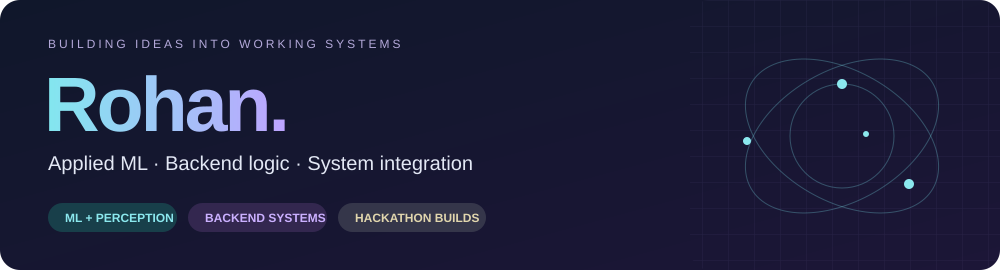

  

  I build hackathon prototypes across <b>machine learning, backend systems and application integration.</b> 
  Here are the projects — and the contributions — you can explore.

  
  
  

---

## SENTINEL 2.5D

**LiDAR perception, from the backend to the browser.**

  
  
  
  
  

I implemented the project end to end: **Python and CUDA C++ backends, pretrained-model integration, compact height grids, WebSocket streaming and a Next.js / WebGL dashboard.** A friend contributed the research; the original Cylinder3D model is credited to its authors.

**[Watch the 60-second walkthrough →](https://github.com/Rohanx777/SENTINEL-2.5D/blob/main/docs/media/sentinel-walkthrough.mp4)** &nbsp; · &nbsp; [Code & setup](https://github.com/Rohanx777/SENTINEL-2.5D) &nbsp; · &nbsp; [Implementation update](https://github.com/Rohanx777/SENTINEL-2.5D/pull/1)

Actual synthetic-fixture demo in CPU mode. Recorded UI timing is not a trained-model benchmark.

---

## AYUSETU

**A team healthcare prototype connecting intake and care workflows.**

AYUSETU team project. My specific contributions are linked below.

  
  
  

My merged contributions:

- **[Multilingual kiosk · PR #3](https://github.com/potlasrisharan/hackshift-sudarshan/pull/3)** — typed intake, consent-gated submission, four-language UI, Elder Mode, API integration and unit/widget tests.
- **[Isolated CBC model API · PR #4](https://github.com/potlasrisharan/hackshift-sudarshan/pull/4)** — frozen inference artifacts, FastAPI endpoints, regression tests and deployment configuration.

**[Explore AYUSETU →](https://github.com/potlasrisharan/hackshift-sudarshan)**

The CBC work is a research demo, not a diagnostic tool.

---

## AMBA

**A team safety prototype built for HACK KRMU 5.0.**

A mobile app, response dashboard and community support in one project. My work across team projects focuses on **ML, backend logic and integration.**

  
  
  

**[Explore AMBA →](https://github.com/Rohanx777/amba)**

---

### Tools I work with

| ML & perception | Backend & data | Apps & integration |
| :--- | :--- | :--- |
| Python · PyTorch · scikit-learn · CUDA | FastAPI · Node.js · TypeScript · Supabase · PostgreSQL | React · Next.js · React Native · Expo · Flutter · Dart |
